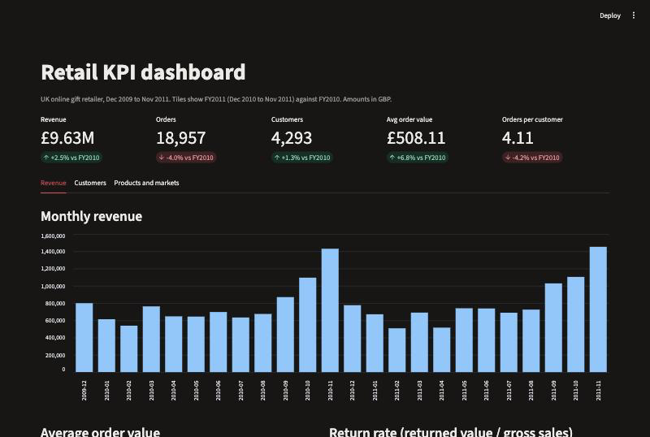
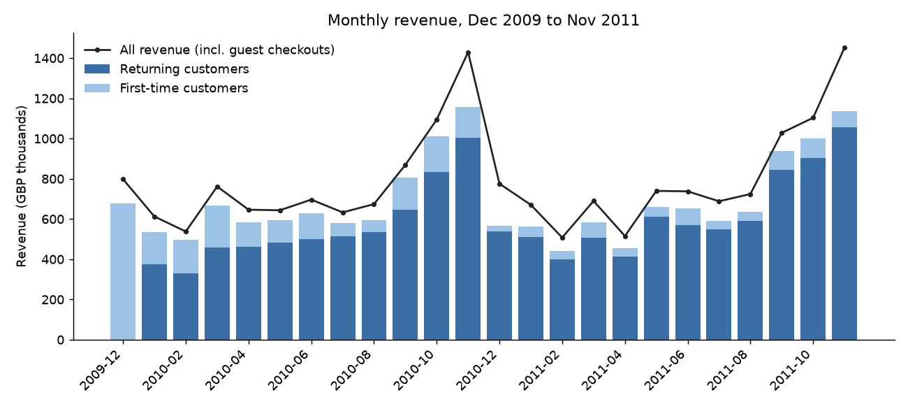
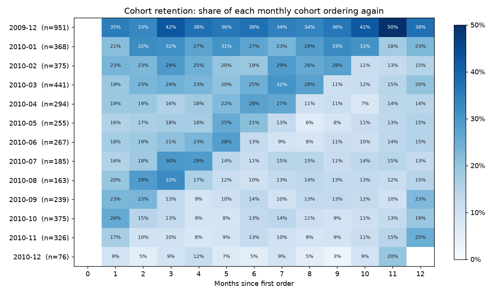
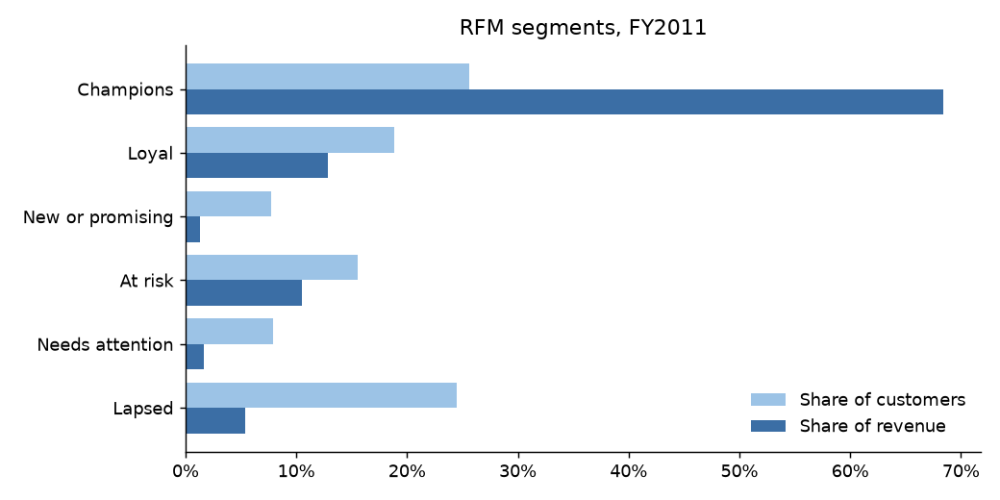

# SQL KPI Dashboard: Online Retail

Two years of invoice lines from a UK online gift retailer, loaded into a small SQLite star schema, analysed with nine plain SQL queries (revenue, order value, new vs returning, cohort retention, RFM, concentration, returns), and served as a Streamlit dashboard.

**Question:** how did the business do in its latest full year, where does the revenue come from, and which customers should it act on first?



## Findings

Fiscal years run December to November (FY2011 = Dec 2010 to Nov 2011). December 2011 is cut off on the 9th and is left out of every comparison.

1. **Revenue grew +2.5% to £9.63M, and the growth came from bigger baskets, not more orders.** Orders moved -4.0% and orders per customer -4.2%, while average order value rose +6.8% to £508.11.
2. **The business runs on repeat buyers.** Returning customers brought 91.2% of FY2011 revenue from known customers. Yet only 20.2% of a typical 2010 cohort ordered again the next month and 18.4% a year later, so first-to-second order conversion is the cheapest lever.
3. **Revenue is concentrated.** The top 10% of customers spent 60.6% of FY2011 revenue and the top 20% spent 74.0%. RFM Champions are 25.6% of customers, 68.4% of revenue, at 9.7 orders each.
4. **668 customers are At risk**: they ordered often in FY2011 but not in the last few months. They spent £864K in FY2011, which makes them the first win-back list.
5. **The year is back-loaded.** September to November brought 37.2% of FY2011 revenue; the peak month was 2011-11 at £1.45M. The UK is 82.3% of known-customer revenue across 37 countries, and returns cost 3.1% of gross sales.

| KPI | FY2010 | FY2011 | Change |
|---|---|---|---|
| Revenue | £9.40M | £9.63M | +2.5% |
| Orders | 19,743 | 18,957 | -4.0% |
| Customers (known) | 4,239 | 4,293 | +1.3% |
| Average order value | £475.91 | £508.11 | +6.8% |
| Orders per customer | 4.29 | 4.11 | -4.2% |
| Revenue per customer | £1,965 | £1,916 | -2.5% |



## Retention



Each row is the group of customers whose first order fell in that month. The first row (Dec 2009, n = 951) holds everyone who was already a customer when the data starts, so it retains far better (37.6% at month 12) and is left out of the averages above.

## RFM segments

Customers who ordered in FY2011, scored 1 to 5 on recency, frequency and spend (`NTILE(5)` in SQL), then grouped by rule.

| Segment | Customers | Days since last order | Orders | Avg spend | Revenue |
|---|---|---|---|---|---|
| Champions | 1,100 (25.6%) | 12 | 9.7 | £5,115.44 | £5.63M (68.4%) |
| Loyal | 807 (18.8%) | 36 | 3.5 | £1,307.56 | £1.06M (12.8%) |
| New or promising | 330 (7.7%) | 15 | 1.2 | £317.38 | £105K (1.3%) |
| At risk | 668 (15.6%) | 148 | 3.3 | £1,293.38 | £864K (10.5%) |
| Needs attention | 338 (7.9%) | 49 | 1.1 | £394.79 | £133K (1.6%) |
| Lapsed | 1,050 (24.5%) | 216 | 1.1 | £419.68 | £441K (5.4%) |



## Top products, FY2011

| Rank | Product | Revenue | Units | Share |
|---|---|---|---|---|
| 1 | Regency Cakestand 3 Tier | £168K | 13,402 | 1.8% |
| 2 | White Hanging Heart T-Light Holder | £102K | 36,826 | 1.1% |
| 3 | Party Bunting | £99K | 18,147 | 1.0% |
| 4 | Jumbo Bag Red Retrospot | £92K | 47,266 | 0.9% |
| 5 | Medium Ceramic Top Storage Jar | £81K | 77,826 | 0.9% |

The top 15 products make up 10.6% of revenue; the catalogue is long-tailed.

## Data and cleaning

[UCI Online Retail II](https://archive.ics.uci.edu/dataset/502/online+retail+ii) (CC BY 4.0): 1,067,371 invoice lines, Dec 2009 to Dec 2011, amounts in GBP. `src/etl.py` drops 34,335 exact duplicate lines and 5,980 non-product lines (postage, fees, manual adjustments), moves cancellations to their own table, and drops 5,928 lines with zero price or other bad quantities. Lines without a customer id are guest checkouts: they count toward revenue and orders but not toward customer metrics.

```
dim_customer  5,852 rows   customer_id, country, first_order_date, cohort_month
dim_product   4,878 rows   stock_code, description
fact_sales    1,003,214 rows   one row per invoice line
fact_returns  17,914 rows   cancelled lines
v_orders      view, one row per invoice
```

## How it works

```
data/download.py          download the workbook, cache as parquet (not committed)
sql/schema.sql            tables, indexes and the v_orders view
sql/01..09_*.sql          one business question per file
src/etl.py                clean and load data/retail.db
src/kpis.py               run every query, save results/tables/*.csv, metrics.json, figures
src/check_app.py          run the dashboard headlessly and fail on any error
src/report.py             render this README from results/
app.py                    Streamlit dashboard; every panel runs a file from sql/
notebooks/01_analysis.ipynb   the queries step by step
```

## Run it

```bash
python -m venv .venv && source .venv/bin/activate
pip install -r requirements.txt
./run_all.sh
streamlit run app.py
```

About two minutes, most of it reading the Excel workbook once. Every number above is read from `results/metrics.json` and `results/tables/`, which the run regenerates.
