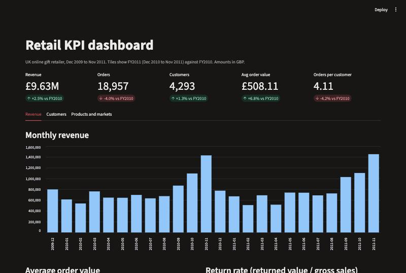
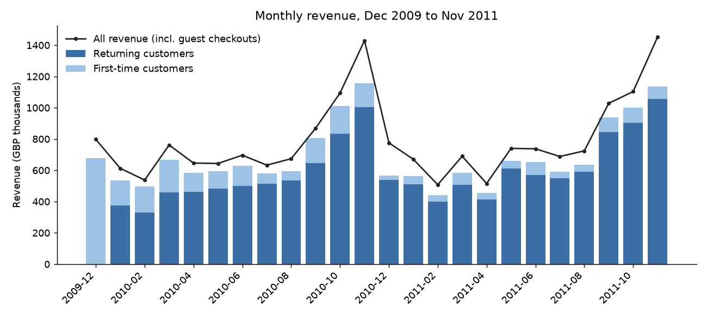
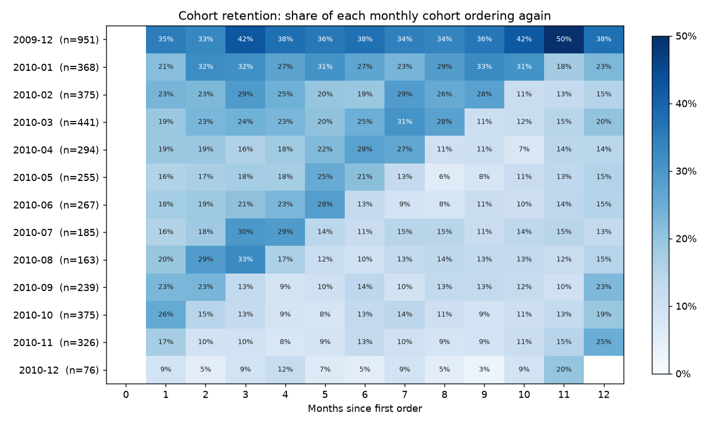
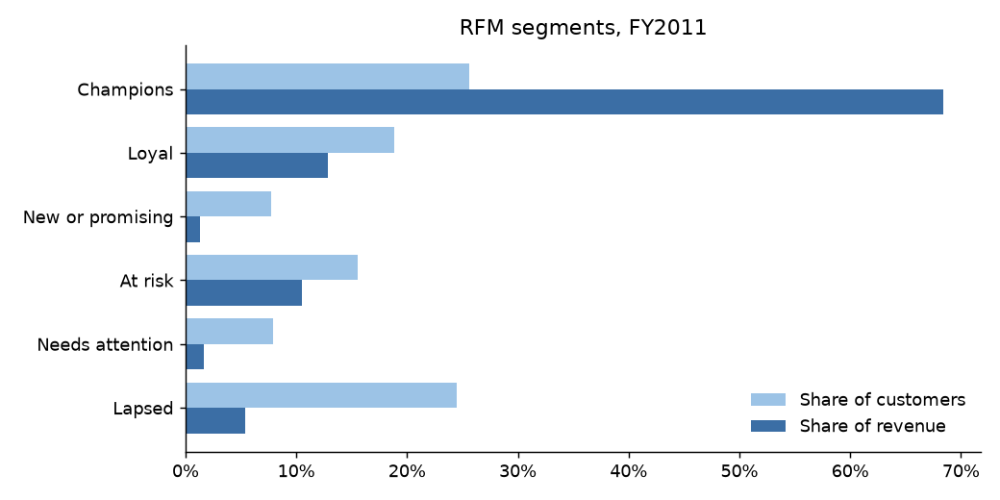

# SQL KPI Dashboard: Online Retail

Two years of invoice lines from a UK online gift retailer, loaded into a small SQLite star schema, analysed with nine plain SQL queries (revenue, order value, new vs returning, cohort retention, RFM, concentration, returns), and served as a Streamlit dashboard.

**Question:** how did the business do in its latest full year, where does the revenue come from, and which customers should it act on first?



## Findings

Fiscal years run December to November (FY2011 = Dec 2010 to Nov 2011). December 2011 is cut off on the 9th and is left out of every comparison.

{{FINDINGS}}

| KPI | FY2010 | FY2011 | Change |
|---|---|---|---|
{{KPI_TABLE}}



## Retention



Each row is the group of customers whose first order fell in that month. The first row (Dec 2009, n = {{DEC_SIZE}}) holds everyone who was already a customer when the data starts, so it retains far better ({{DEC_12}} at month 12) and is left out of the averages above.

## RFM segments

Customers who ordered in FY2011, scored 1 to 5 on recency, frequency and spend (`NTILE(5)` in SQL), then grouped by rule.

| Segment | Customers | Days since last order | Orders | Avg spend | Revenue |
|---|---|---|---|---|---|
{{RFM_TABLE}}



## Top products, FY2011

| Rank | Product | Revenue | Units | Share |
|---|---|---|---|---|
{{PRODUCT_TABLE}}

The top 15 products make up {{TOP15}} of revenue; the catalogue is long-tailed.

## Data and cleaning

[UCI Online Retail II](https://archive.ics.uci.edu/dataset/502/online+retail+ii) (CC BY 4.0): {{RAW}} invoice lines, Dec 2009 to Dec 2011, amounts in GBP. `src/etl.py` drops {{DUPES}} exact duplicate lines and {{NONPROD}} non-product lines (postage, fees, manual adjustments), moves cancellations to their own table, and drops {{OTHER}} lines with zero price or other bad quantities. Lines without a customer id are guest checkouts: they count toward revenue and orders but not toward customer metrics.

```
dim_customer  {{CUSTOMERS}} rows   customer_id, country, first_order_date, cohort_month
dim_product   {{PRODUCTS}} rows   stock_code, description
fact_sales    {{SALES}} rows   one row per invoice line
fact_returns  {{RETURNS}} rows   cancelled lines
v_orders      view, one row per invoice
```

## How it works

```
data/download.py          download the workbook, cache as parquet (not committed)
sql/schema.sql            tables, indexes and the v_orders view
sql/01..09_*.sql          one business question per file
src/etl.py                clean and load data/retail.db
src/kpis.py               run every query, save results/tables/*.csv, metrics.json, figures
src/check_app.py          run the dashboard headlessly and fail on any error
src/report.py             render this README from results/
app.py                    Streamlit dashboard; every panel runs a file from sql/
notebooks/01_analysis.ipynb   the queries step by step
```

## Run it

```bash
python -m venv .venv && source .venv/bin/activate
pip install -r requirements.txt
./run_all.sh
streamlit run app.py
```

About two minutes, most of it reading the Excel workbook once. Every number above is read from `results/metrics.json` and `results/tables/`, which the run regenerates.
